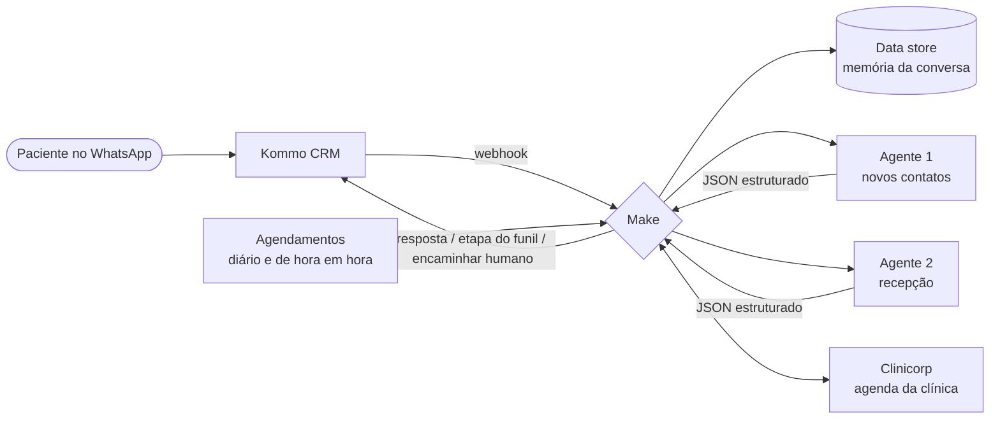

# 🦷 IA de Atendimento para Clínica Odontológica

Sistema de **atendimento automatizado com IA no WhatsApp**, criado e mantido por mim numa clínica odontológica real, **em produção desde agosto de 2026**.

São **2 agentes de IA** que conversam com os pacientes e **4 automações** que cuidam da jornada do paciente: confirmação, lembretes, faltas e pesquisa de satisfação. Tudo integrado ao CRM (Kommo) e ao sistema da clínica (Clinicorp), com o **Make**.

> Publicado com autorização da clínica. Credenciais, IDs, URLs, prompts completos e qualquer dado de paciente foram removidos.

## Resultados

| | |
|---|---|
| 🤖 Interações atendidas pela IA | **1.100+** |
| ✅ Confirmações de consulta automáticas | **600+** |
| ⭐ Pesquisas de satisfação (NPS) enviadas | **260+** |
| 🕐 Atendimento | **24 horas**, inclusive fora do horário da clínica |
| 📉 Faltas | **diminuíram** depois dos lembretes automáticos |

## O problema

A recepção respondia o WhatsApp manualmente, só no horário comercial. Quem mandava mensagem à noite ou no fim de semana esperava até o dia seguinte. Confirmar consultas e lembrar os pacientes também tomava horas de ligações e mensagens, e as faltas deixavam horários vazios na agenda.

## Arquitetura

### Agentes de IA (OpenAI via Make)

| Agente | O que faz |
|---|---|
| **1. Atendimento de novos contatos** | Responde quem chega pelo WhatsApp (inclusive por anúncios), tira dúvidas sobre tratamentos e valores, contorna objeções e leva o contato até o agendamento. |
| **2. Recepção de pacientes** | Identifica o motivo do contato (dor, prótese, financeiro, agendamento ou outros) e direciona ao setor certo. |

Os dois agentes:
- guardam o **histórico da conversa** por contato (data store do Make);
- respondem em **JSON Schema estrito** (resposta, nome do paciente, se deve chamar humano, setor de destino);
- **pausam sozinhos** quando um atendente humano assume a conversa;
- movem o lead no **funil do Kommo** de acordo com a conversa.

A estrutura dos prompts e as técnicas usadas estão em [`prompts/estrutura-dos-prompts.md`](prompts/estrutura-dos-prompts.md).

### Automações da jornada do paciente

| Fluxo | Gatilho | O que faz |
|---|---|---|
| **Confirmação de agendamento** | Paciente confirma no WhatsApp | Grava a confirmação direto na agenda do Clinicorp. |
| **Lembretes de consulta** | Todo dia às 8h | Envia pedido de confirmação 2 dias antes, lembrete na véspera e no dia. Quem ainda não confirmou recebe nova mensagem. |
| **Reagendamento de faltas** | Lead muda de etapa no Kommo | Atualiza o status da consulta no Clinicorp. |
| **Pesquisa NPS** | De hora em hora, em horário comercial | Envia a pesquisa de satisfação depois do atendimento, uma única vez por consulta. |

A estrutura de cada cenário (módulos, rotas e filtros, sem dados sensíveis) está na pasta [`cenarios/`](cenarios/).

## Desafios técnicos que resolvi

- **Telefones em formatos diferentes:** o Clinicorp e o Kommo guardam números de jeitos diferentes, com ou sem o 9º dígito e com ou sem +55. Fiz uma normalização com uma segunda busca automática quando o contato não é encontrado na primeira.
- **Mensagens duplicadas:** quem tem duas consultas no mesmo dia recebe só um lembrete. Na NPS, um data store garante que a pesquisa é enviada só uma vez por consulta.
- **Erros que não são erros:** o Clinicorp devolve erro quando a consulta "já foi alterada". O fluxo ignora esse caso e só registra os erros reais.
- **IA x humano:** quando a equipe assume a conversa, a IA pausa para não responder por cima do atendente.
- **Mudanças seguras:** cada alteração em cenário ou prompt gera um backup versionado antes de ir para produção.

## Ferramentas

`Make` · `OpenAI API` · `Kommo CRM` · `WhatsApp` · `Clinicorp API` · `webhooks` · `JSON Schema` · engenharia de prompt

---

Feito por **Rafael da Silveira Gonçales** · [LinkedIn](https://www.linkedin.com/in/rafael-da-silveira-gonçales-971ab81b3) · [GitHub](https://github.com/Rafael8353)
